
 <h1>🐾 PawLink – Pet Adoption App</h1> 
<b>Adopt, Don't Shop. Give a home, give love, change a life.</b>

Show Image Show Image Show Image Show Image

 

📖 About The Project

Every day, thousands of pets are left without a home, and many people who want to adopt do not know where to start. PawLink brings both sides together in one simple app.

With PawLink, users can explore pets, filter by type, breed, age and gender, view full pet profiles, and send an adoption request in a few taps. Users can also report a stray or injured animal so rescuers can help, and track their adoption application step by step. Admins manage everything from a dedicated dashboard.

A Brighter Tomorrow for Every Paw 🐶🐱

✨ Features
👤 For Users
🔐 Sign up and login (email, Google, Facebook)
🏠 Home screen with pet categories: Dogs, Cats, Rabbits, Birds and Others
🌟 Featured pets section
🔍 Smart search with filters: animal type, breed, age, gender and location
📄 Detailed pet profile with photos, health, vaccination and temperament info
📝 Adoption application form
❤️ Favorites list to save pets you love
📍 Rescue report: upload photos, add location and describe the situation
📦 Adoption tracking: Submitted → Under Review → Home Visit → Approved → Pet Handover
👤 Profile with application history, favorites and reports
🛡️ For Admin
📊 Dashboard with total pets, adoption requests, rescue reports and adopted pets
🐕 Manage pets (add, edit, remove)
✅ Review adoption requests
🚨 View rescue reports
👥 Manage users
📸 Screenshots
Getting Started
Splash	Onboarding	Login / Sign Up
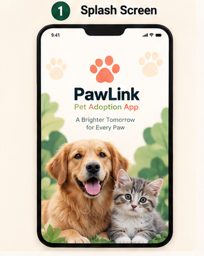	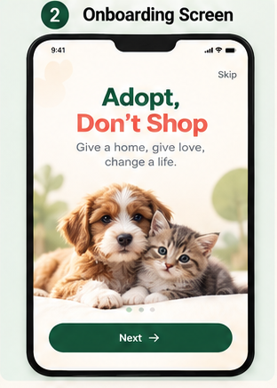	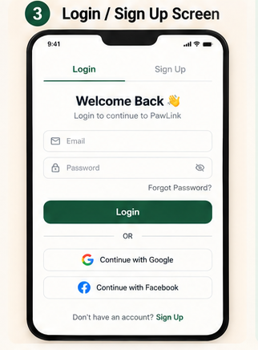
Explore & Adopt
Home	Search & Filter	Pet Details
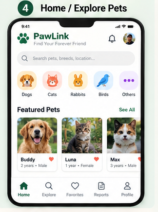	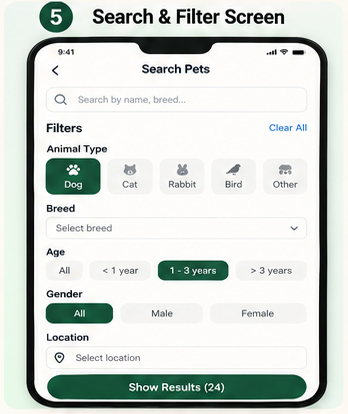	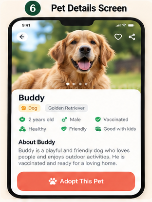
Adoption Form	Favorites	Adoption Tracking
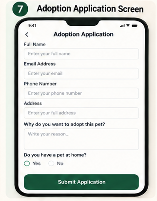	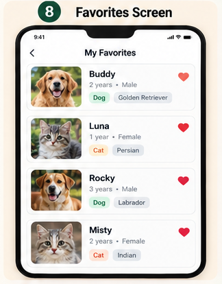	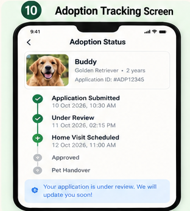
Rescue, Profile & Admin
Rescue Report	Profile	Admin Dashboard
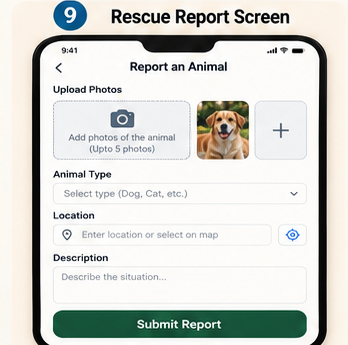	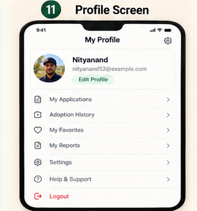	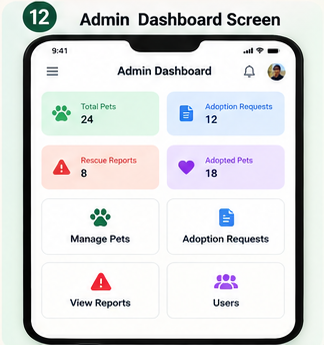
🛠️ Tech Stack
Category	Technology
Frontend / App	[Flutter / React Native / Android (Kotlin) / React]
Backend	[Firebase / Node.js + Express]
Database	[Firebase Firestore / MongoDB / MySQL]
Authentication	[Firebase Auth / JWT, Google & Facebook Login]
Design	Figma / AI-generated UI mockups
Tools	Git, GitHub, VS Code

✏️ Replace the brackets with the technologies you actually used.

📂 Project Structure
text
pet-adoption-app/
├──           # App screens used in this README
├── src/                  # Source code
│   ├── screens/
│   ├── components/
│   └── services/
├── package.json
└── README.md

✏️ Match this tree with your real folders.

🚀 Getting Started
Prerequisites
Git
Node.js (v16 or above)
[Android Studio / Flutter SDK, if required]
Installation
bash
# 1. Clone the repository
git clone https://github.com/Nityanand52/pet-adoption-app.git

# 2. Go to the project folder
cd pet-adoption-app

# 3. Install dependencies
npm install

# 4. Run the app
npm start
🗺️ Roadmap
 UI/UX design of all 12 screens
 Authentication (Email, Google, Facebook)
 Pet listing, search and filters
 Adoption application and tracking
 Rescue report with image upload
 Admin dashboard
 Push notifications
 In-app chat with shelters
👥 Team
Name	Role	GitHub
Nityanand	Team Lead, Development	@Nityanand52
Nandani Sharma	UI/UX Design & Documentation	@your-username

✏️ Change the roles to match who did what.

🤝 Contributing
Fork the project
Create your branch: git checkout -b feature/NewFeature
Commit your changes: git commit -m "Add NewFeature"
Push the branch: git push origin feature/NewFeature
Open a Pull Request
📄 License

Distributed under the MIT License.

Made with ❤️ by Nityanand & Nandani Sharma

⭐ If you like this project, give it a star! ⭐

